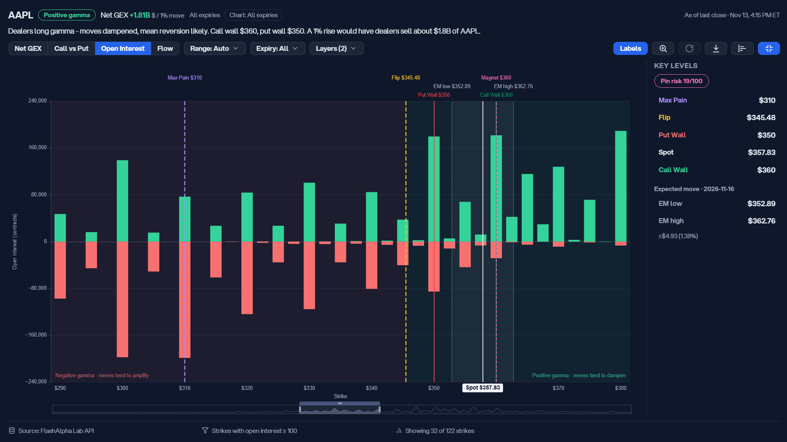

<p align="center">
  <a href="https://flashalpha.com/?utm_source=github&utm_medium=readme&utm_campaign=gex-charts">
    
  </a>
</p>

<h1 align="center">FlashAlpha GEX Charts</h1>

<p align="center">
  <strong>Interactive gamma exposure (GEX) by strike chart for stocks, ETFs, indices and futures.</strong><br>
  Call wall, put wall, gamma flip and max pain from the <a href="https://flashalpha.com/?utm_source=github&utm_medium=readme&utm_campaign=gex-charts">FlashAlpha</a> options analytics API. Built on Apache ECharts.
</p>

<p align="center">
  <a href="https://www.npmjs.com/package/@flashalpha-lab/gex-charts"></a>
  <a href="https://www.npmjs.com/package/@flashalpha-lab/gex-charts"></a>
  
  <a href="LICENSE"></a>
</p>

<p align="center">
  
</p>

**FlashAlpha GEX Charts** is an open-source JavaScript library that draws an interactive gamma exposure (GEX) by strike chart from the [FlashAlpha options analytics API](https://flashalpha.com/docs/lab-api-overview?utm_source=github&utm_medium=readme&utm_campaign=gex-charts). Add your FlashAlpha API key and a ticker symbol, and it shows net dealer gamma at every strike together with the call wall, put wall, gamma flip, max pain and spot price. It works like ECharts: call `init` on a DOM element, then control the chart with methods and events.

- **One line to start:** `FlashAlphaGex.init(el, { apiKey, symbol: 'SPY' })`.
- **Live data:** refreshes during market hours. How often depends on your FlashAlpha plan.
- **Four views:** Net GEX, Call vs Put, Open Interest, and Flow (session dealer flow).
- **Key levels:** call wall, put wall, gamma flip, max pain, spot, plus expected move, pin risk and 0DTE overlays.
- **Any expiry:** the whole option chain or a single expiry, including 0DTE.
- **Stocks, ETFs, indices and futures:** `SPY`, `QQQ`, `NVDA`, `SPX`, `ES=F`, `NQ=F` and more.
- **Ready for production:** light and dark themes, responsive (desktop, tablet, phone), horizontal or vertical bars, zoom, full screen, PNG export, TypeScript types.
- **Framework-free:** plain JavaScript that works with React, Vue, Angular, Svelte, or a single HTML file. Its CSS is scoped to the chart, so it never restyles your page.

---

## Table of contents

- [What is gamma exposure (GEX)?](#what-is-gamma-exposure-gex)
- [Quick start](#quick-start)
- [How do I add my FlashAlpha API key?](#how-do-i-add-my-flashalpha-api-key)
- [Use without a bundler (CDN)](#use-without-a-bundler-cdn)
- [Use with no JavaScript (HTML attributes)](#use-with-no-javascript-html-attributes)
- [Framework examples](#framework-examples)
- [Options](#options)
- [Methods](#methods)
- [Events](#events)
- [Chart modes](#chart-modes)
- [Keep your API key safe](#keep-your-api-key-safe)
- [Plans and features](#plans-and-features)
- [FAQ](#faq)
- [About FlashAlpha](#about-flashalpha)

---

## What is gamma exposure (GEX)?

**Gamma exposure (GEX)** estimates how much option dealers must buy or sell the underlying when its price moves. The estimate comes from each strike's open interest and gamma. When dealers are net long gamma, their hedging tends to dampen price moves. When they are net short gamma, their hedging tends to amplify them.

The FlashAlpha GEX chart marks the levels traders watch most:

| Level | Meaning |
|---|---|
| **Call wall** | The strike with the largest positive call gamma. It often acts as resistance. |
| **Put wall** | The strike with the largest negative put gamma. It often acts as support. |
| **Gamma flip** | The price where net dealer gamma changes sign, between the positive and the negative gamma regime. |
| **Max pain** | The strike at which the most option value expires worthless. |
| **Spot** | The current price of the underlying. |

Learn more in the [FlashAlpha exposure API docs](https://flashalpha.com/docs/lab-api-exposure?utm_source=github&utm_medium=readme&utm_campaign=gex-charts).

---

## Quick start

### 1. Install

```bash
npm install @flashalpha-lab/gex-charts echarts
```

`echarts` (v6.1 or later) is a peer dependency, so your app controls the ECharts version.

### 2. Get a FlashAlpha API key

[Create a free FlashAlpha account](https://flashalpha.com/pricing?utm_source=github&utm_medium=readme&utm_campaign=get_api_key), then copy your API key from your [FlashAlpha profile](https://flashalpha.com/profile?utm_source=github&utm_medium=readme&utm_campaign=get_api_key).

### 3. Draw the chart

```html
<div id="gex"></div>
```

```js
import * as echarts from 'echarts';
import * as FlashAlphaGex from '@flashalpha-lab/gex-charts';

const chart = FlashAlphaGex.init(document.getElementById('gex'), {
  apiKey: 'YOUR_FLASHALPHA_API_KEY',
  symbol: 'SPY',
  echarts
});
```

Replace `YOUR_FLASHALPHA_API_KEY` with your key. You now have a live gamma exposure chart for SPY. The chart injects its own scoped CSS, so there is nothing else to import.

---

## How do I add my FlashAlpha API key?

Use the same placeholder, `YOUR_FLASHALPHA_API_KEY`, in whichever setup you use.

**JavaScript option**

```js
FlashAlphaGex.init(el, { apiKey: 'YOUR_FLASHALPHA_API_KEY', symbol: 'SPY' });
```

**HTML attribute**

```html
<div data-flashalpha-gex data-symbol="SPY" data-api-key="YOUR_FLASHALPHA_API_KEY"></div>
```

**Environment variable (Vite)**

`.env`

```bash
VITE_FLASHALPHA_API_KEY=YOUR_FLASHALPHA_API_KEY
```

```js
FlashAlphaGex.init(el, { apiKey: import.meta.env.VITE_FLASHALPHA_API_KEY, symbol: 'SPY', echarts });
```

**Environment variable (Next.js)**

```bash
NEXT_PUBLIC_FLASHALPHA_API_KEY=YOUR_FLASHALPHA_API_KEY
```

**Your own server (recommended for public websites)**

```js
FlashAlphaGex.init(el, { apiBase: '/api/flashalpha', symbol: 'SPY', echarts });
```

See [Keep your API key safe](#keep-your-api-key-safe).

The library reads your plan from the key (`GET /v1/account`, which does not count against your quota), so each feature is turned on or locked to match your FlashAlpha plan. You do not need any other setting.

---

## Use without a bundler (CDN)

```html
<!doctype html>
<html>
  <body>
    <div id="gex"></div>

    <script src="https://cdn.jsdelivr.net/npm/echarts@6.1.0/dist/echarts.min.js"></script>
    <script src="https://cdn.jsdelivr.net/npm/@flashalpha-lab/gex-charts@0.1.0/dist/gex-charts.min.js"></script>
    <script>
      FlashAlphaGex.init(document.getElementById('gex'), {
        apiKey: 'YOUR_FLASHALPHA_API_KEY',
        symbol: 'SPY'
      });
    </script>
  </body>
</html>
```

The script build exposes one global, `FlashAlphaGex`, and finds `window.echarts` by itself.

---

## Use with no JavaScript (HTML attributes)

Add one `div` and two script tags. Every element with `data-flashalpha-gex` becomes a chart when the page loads.

```html
<div data-flashalpha-gex
     data-symbol="SPY"
     data-api-key="YOUR_FLASHALPHA_API_KEY"
     data-theme="dark"
     data-mode="compact"
     style="height:480px"></div>

<script src="https://cdn.jsdelivr.net/npm/echarts@6.1.0/dist/echarts.min.js"></script>
<script src="https://cdn.jsdelivr.net/npm/@flashalpha-lab/gex-charts@0.1.0/dist/gex-charts.min.js"></script>
```

Supported attributes: `data-symbol`, `data-api-key`, `data-api-base`, `data-mode`, `data-theme`, `data-view`, `data-range`, `data-expiry`, `data-orientation`, `data-plan`, `data-attribution="false"`.

---

## Framework examples

### React

```jsx
import { useEffect, useRef } from 'react';
import * as echarts from 'echarts';
import * as FlashAlphaGex from '@flashalpha-lab/gex-charts';

export function GexChart({ symbol = 'SPY' }) {
  const ref = useRef(null);

  useEffect(() => {
    const chart = FlashAlphaGex.init(ref.current, {
      apiKey: import.meta.env.VITE_FLASHALPHA_API_KEY,
      symbol,
      echarts
    });
    return () => chart.dispose();
  }, [symbol]);

  return <div ref={ref} />;
}
```

### Vue 3

```vue
<script setup>
import { onMounted, onBeforeUnmount, ref } from 'vue';
import * as echarts from 'echarts';
import * as FlashAlphaGex from '@flashalpha-lab/gex-charts';

const el = ref(null);
let chart;

onMounted(() => {
  chart = FlashAlphaGex.init(el.value, {
    apiKey: import.meta.env.VITE_FLASHALPHA_API_KEY,
    symbol: 'QQQ',
    echarts
  });
});
onBeforeUnmount(() => chart?.dispose());
</script>

<template><div ref="el" /></template>
```

### Angular, Svelte and others

Call `FlashAlphaGex.init(element, options)` after the element is in the DOM, and `chart.dispose()` when the component is destroyed.

More examples are in [`examples/`](examples): a playground page, HTML attributes only, Vite, and a Node proxy.

---

## Options

| Option | Type | Default | Description |
|---|---|---|---|
| `apiKey` | `string | null` | – | Your FlashAlpha API key. `null` shows the no-key view without a plan lookup, even with a custom `apiBase`. |
| `getApiKey` | `() => string \| Promise<string>` | – | Returns the key at request time, instead of `apiKey`. |
| `symbol` | `string` | `'SPY'` | Ticker. Futures use the `=F` suffix, for example `ES=F`. |
| `assetType` | `'stock' \| 'futures'` | from the symbol | |
| `mode` | `'full' \| 'compact' \| 'zero-dte'` | `'full'` | See [Chart modes](#chart-modes). |
| `theme` | `'dark' \| 'light' \| 'auto' \| 'class'` | `'auto'` | `auto` follows the visitor's system theme. `class` follows `class="dark"` on `<html>`. |
| `view` | `'net' \| 'callput' \| 'oi' \| 'flow'` | `'net'` | Starting view. |
| `range` | `0.05 \| 0.1 \| 0.2 \| 'all' \| 'auto'` | `'auto'` | Strike window around spot. |
| `expiry` | `'auto' \| 'all' \| 'YYYY-MM-DD'` | `'auto'` | Whole chain or a single expiry. `auto` picks the best one your plan allows. |
| `orientation` | `'horizontal' \| 'vertical'` | `'horizontal'` | |
| `layers` | `{ em, pin, zdte, trail }` | by plan | Expected move, pin risk, 0DTE overlay, flip trail. |
| `features` | `object` | all on | `{ levelsRail, maxPain, export, fullscreen, orientation, layers, live, labels }`. |
| `echarts` | ECharts namespace | `window.echarts` | |
| `echartsUrl` | `string` | – | Loads ECharts from this URL when none is found, once the chart nears the screen. |
| `apiBase` | `string` | `'https://lab.flashalpha.com'` | Point it to your own proxy to keep the key on your server. |
| `headers` | `() => object` | – | Extra request headers. |
| `plan` | `'free' \| 'basic' \| 'growth' \| 'alpha'` | read from the key | Skips the plan lookup. |
| `data` | `{ summary, gex }` or `{ zeroDte }` | – | Draw FlashAlpha API responses you already have. No requests are sent. |
| `summary` | object | – | A summary response you already have, so the chart does not fetch it again. |
| `fetch` | `(url, init) => Promise<Response>` | `window.fetch` | Your own fetch, for example to share a request queue. |
| `maxConcurrent` | `number` | `3` | The most API requests sent at the same time. |
| `storage` | `'local' \| 'none'` | `'local'` | Remembers the visitor's view, range and layers. |
| `storagePrefix` | `string` | `'flashalpha-gex'` | |
| `injectCss` | `boolean` | `true` | Set `false` under a strict CSP and import `@flashalpha-lab/gex-charts/style.css` instead. |
| `cssNonce` | `string` | – | CSP nonce for the injected style tag. |
| `attribution` | `boolean` | `true` | Shows "GEX data by FlashAlpha" under the chart. Set `false` to hide it. |
| `upgradeUrl` | `(plan) => string` | FlashAlpha pricing page | Where the "Upgrade" buttons of locked features link to. |
| `upgradeNote` | `(plan) => string` | – | A line in the upgrade dialog, for example the plan's price. |
| `upgradeAttrs` | `object` | – | Extra `data-*` attributes on the upgrade dialog's button, for example for analytics. |
| `guestCta` | `{ title, text, label, href, attrs }` | API key prompt | Text and link shown when there is no API key. `attrs` adds `data-*` attributes to the link, for example for analytics. |
| `delayedCta` | `{ text, href, attrs }` | – | Link next to the "Delayed" chip while the data is delayed. |
| `top` | `number` | – | `compact` mode: keep only the N strikes with the largest net GEX. |
| `zoomBar` | `boolean` | `true` | `compact` mode: show the zoom slider. |
| `labelsMobile` | `boolean` | `false` | `compact` mode: show level labels on phones. |
| `on` | `{ [event]: handler }` | – | Event handlers registered before the first request. |

## Methods

```js
chart.setSymbol('NVDA');
chart.setOption({ view: 'callput', range: 0.05, theme: 'light' });
chart.setExpiry('all');
chart.refresh();
chart.resize();
const png = chart.getDataURL();
chart.dispose();
```

| Method | Description |
|---|---|
| `setSymbol(symbol, assetType?)` | Load another ticker. |
| `setOption(partial)` | Change `view`, `range`, `expiry`, `theme`, `orientation` or `layers` in place. Any other option rebuilds the chart. |
| `setView`, `setRange`, `setExpiry`, `setTheme`, `setOrientation` | Shortcuts for `setOption`. |
| `setData(data)` | Redraw from your own API responses. |
| `refresh()` | Fetch fresh data now. Returns `false` when called again within 15 seconds. |
| `resize()` | Re-measure the container. Usually automatic. |
| `getModel()` | The data on screen: strikes, levels, spot, expiry. |
| `getStatus()` | `loading`, `ready`, `guest`, `locked`, `limit`, `empty`, `not_found` or `error`. |
| `getDataURL()` | PNG image of the chart. |
| `getDom()` | The element passed to `init`. |
| `on(event, fn)` / `off(event, fn)` | Listen to events. |
| `dispose()` / `isDisposed()` | Remove the chart and free its resources. |

Static functions: `FlashAlphaGex.init`, `FlashAlphaGex.dispose(el)`, `FlashAlphaGex.getInstanceByDom(el)`, `FlashAlphaGex.autoInit(root?)`, `FlashAlphaGex.version`.

The data model alone (no DOM, no ECharts) is available as `import model from '@flashalpha-lab/gex-charts/model'`, or as `dist/gex-charts-model.min.js` with the global `FlashAlphaGexModel`. It turns FlashAlpha API responses into strikes and levels and formats numbers, for example `model.fmtGex(1.2e9)`.

## Events

```js
chart.on('ready', ({ model }) => console.log(model.callWall, model.putWall, model.flip));
chart.on('locked', ({ feature, requiredPlan }) => console.log(feature, requiredPlan));
```

| Event | Payload | When |
|---|---|---|
| `ready` | `{ model, raw }` | Data loaded and drawn. |
| `loading` | `{ symbol, refresh }` | A request started. |
| `live-update` | `{ model }` | A live refresh arrived. |
| `view-change`, `range-change`, `expiry-change`, `orientation-change` | new value | The visitor changed a control. |
| `level-click` | `{ key, price, scope }` | A level was picked. |
| `locked` | `{ feature, requiredPlan, reason }` | A feature needs an API key or a higher FlashAlpha plan. |
| `rate-limited` | `{ kind, resetAt, retryAfter }` | Daily quota or concurrency limit reached. |
| `empty` | `{ expiry }` | No data for this symbol or expiry. |
| `error` | `{ kind, status }` | Network, API or ECharts error. |
| `dispose` | – | The chart was removed. |

---

## Chart modes

| Mode | What you get | Height |
|---|---|---|
| `full` | Toolbar, views, range, expiry picker, layers, level chips, levels list, conclusion line, footer. | Sets its own height. |
| `compact` | The chart only: bars, levels and spot. Fits a dashboard card. | Fills the container, so give the container a height. |
| `zero-dte` | Same-day (0DTE) gamma exposure from `/v1/exposure/zero-dte`, with tighter ranges. | Sets its own height. |

---

## Keep your API key safe

An API key placed in browser code can be read by anyone who opens the page.

- **Personal or internal pages:** pass `apiKey` directly.
- **Public websites:** keep the key on your server and set `apiBase` to a small proxy that adds the `X-Api-Key` header. A ready-to-run Node example is in [`examples/proxy`](examples/proxy).

The library sends the key only in the `X-Api-Key` header. It never stores the key, writes it to the URL or logs it.

---

## Plans and features

The chart works on every FlashAlpha plan, including the free plan. It reads your plan from your API key and turns on the features that plan includes:

| Feature | Lowest FlashAlpha plan |
|---|---|
| GEX by strike for the next expiry (stocks) | Free |
| ETFs and indices | Basic |
| Expected move overlay, flip trail, live refresh | Basic |
| All expiries combined, same-day (0DTE) expiry, futures (`ES=F`, `NQ=F`) | Growth |
| Pin risk and 0DTE overlays, live price | Growth |
| Flow view (session dealer flow), fastest live refresh | Alpha |

Locked features stay visible with a lock icon. Clicking one opens an upgrade dialog inside the chart (it works in full screen too) with a link to the plan that unlocks it, and the library sends no request for it. See [FlashAlpha pricing](https://flashalpha.com/pricing?utm_source=github&utm_medium=readme&utm_campaign=plans) for prices and daily request limits.

---

## FAQ

**Is FlashAlpha GEX Charts free?**
The library is free and open source under the MIT license. The data comes from the FlashAlpha API, which needs an API key. A free FlashAlpha plan is available.

**Which symbols are supported?**
US stocks, ETFs and indices such as SPY, QQQ, SPX, NVDA, TSLA and AAPL, and futures such as ES=F and NQ=F. Some symbol types need a paid plan.

**How often does the chart update?**
During US market hours it refreshes on its own. How often depends on your FlashAlpha plan. Outside market hours it shows the last close.

**Does it work with React, Vue, Angular or Svelte?**
Yes. It is plain JavaScript with no framework dependency. See [Framework examples](#framework-examples).

**Will it change the styles of my page?**
No. Every CSS rule of the chart is scoped to the chart element, and the chart does not ship a CSS reset for your page.

**Can I use it without an API key?**
Without a key, the chart shows the public levels for the symbol and asks for a key to draw GEX by strike. You can also draw FlashAlpha API responses you already have with the `data` option.

**Can I show 0DTE gamma exposure?**
Yes. Use `mode: 'zero-dte'`, or turn on the 0DTE overlay in the full chart.

**Why is ECharts a peer dependency?**
So your app loads one copy of ECharts and controls its version.

**Is my API key safe?**
Read [Keep your API key safe](#keep-your-api-key-safe). On public sites, use a proxy.

**Where can I get help?**
Open an issue at https://github.com/ngvtuan-fa/gex-chart/issues, or see the [FlashAlpha docs](https://flashalpha.com/docs?utm_source=github&utm_medium=readme&utm_campaign=gex-charts).

---

## About FlashAlpha

[FlashAlpha](https://flashalpha.com/?utm_source=github&utm_medium=readme&utm_campaign=gex-charts) provides options analytics through a REST API: gamma exposure (GEX), delta and vanna exposure, key levels, 0DTE analytics, option flow, volatility and historical data for stocks, ETFs, indices and futures. FlashAlpha GEX Charts is the official open-source chart for that data.

- [API docs](https://flashalpha.com/docs?utm_source=github&utm_medium=readme&utm_campaign=gex-charts)
- [Pricing and free API key](https://flashalpha.com/pricing?utm_source=github&utm_medium=readme&utm_campaign=gex-charts)
- [Free GEX tool on flashalpha.com](https://flashalpha.com/tools/gamma-exposure?utm_source=github&utm_medium=readme&utm_campaign=gex-charts)

## Development

```bash
npm install
npm test          # unit and jsdom tests
npm run build     # dist/: ESM, CommonJS, script build and CSS
npm run check     # no comments in src, types, tests, build, package contents
```

## License

[MIT](LICENSE) © FlashAlpha. Built on [Apache ECharts](https://echarts.apache.org/) (Apache-2.0).
